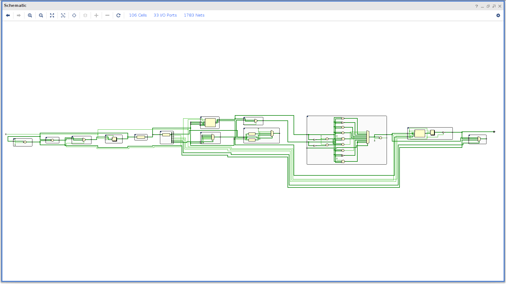

# CPU

My first go at a 32-bit RISC-V processor in Verilog. It is a single-cycle
design: each instruction is fetched, decoded, executed and written back in one
clock cycle.

## What's inside

| File (`rtl_codes/`) | What it does |
|---|---|
| `top_module.v` | Connects everything together |
| `PC.v` | Program counter |
| `instructionmemory.v` | 512-word instruction memory, preloaded with the demo program |
| `controlunit.v` | Main decoder: opcode → control signals |
| `ALUcontrol.v` | Picks the ALU operation from funct3/funct7 |
| `regfile.v` | 32 x 32-bit register file |
| `ImmGen.v` | Immediate generator (I, S, B and J formats) |
| `ALU.v` | add, sub, and, or, xor, sll, srl, sra, slt, sltu |
| `DataMemory.v` | 512-word data memory |
| `mux.v`, `mux_4x1.v` | ALU input and write-back muxes |
| `adder.v`, `add.v` | Next-PC and branch-target adders |
| `isa.asm` | The demo program in assembly |

The control unit decodes R-type, I-type ALU, `lw`, `sw`, branch, `jal` and
`jalr` instructions.

## Demo program

`isa.asm` (preloaded in `instructionmemory.v`) builds the Fibonacci sequence: it
keeps adding the last two numbers, stores each one into data memory, and then
loads them back with `lw`.

## Notes

- Memories are word-addressed, so the PC goes up by 1 per instruction instead of 4.
- There is no testbench yet.
- `resources/` has the RISC-V spec and assembly manual I used while building it.

Things I'd like to add next: a self-checking testbench, using the ALU zero flag
for branch decisions, wiring up the jump path for `jal`/`jalr`, and byte
addressing (PC + 4).
